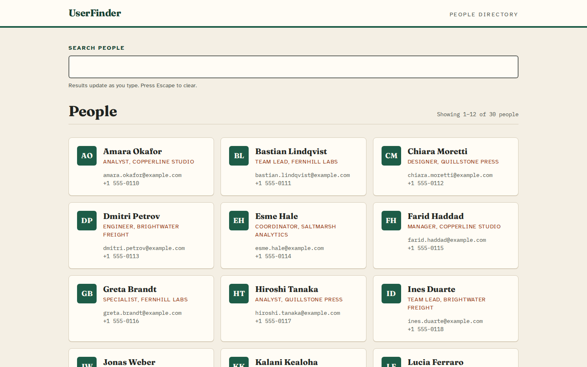
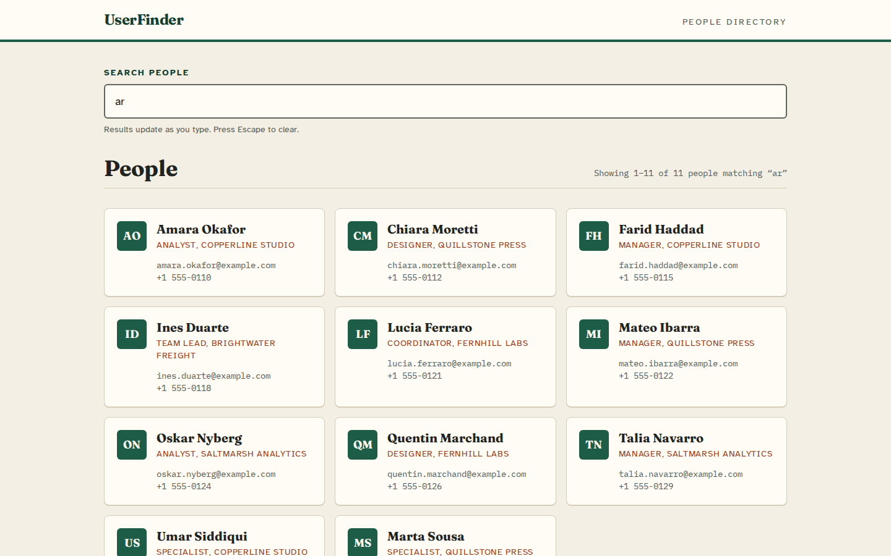
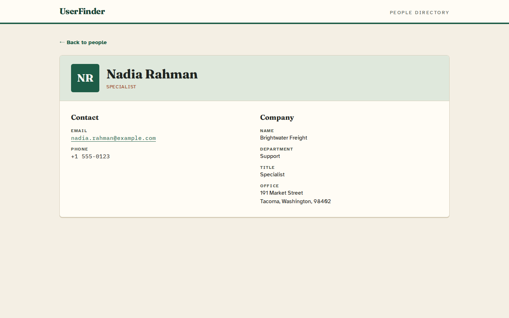
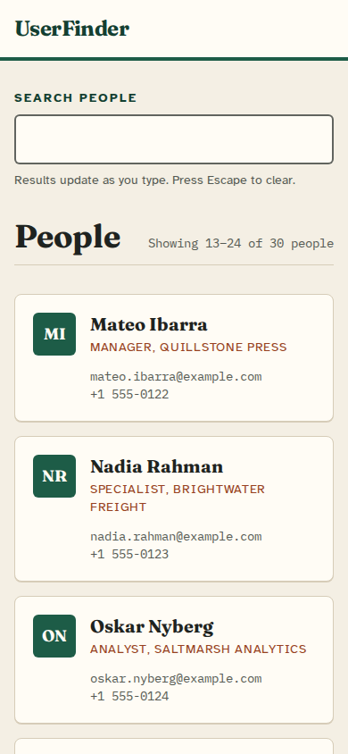
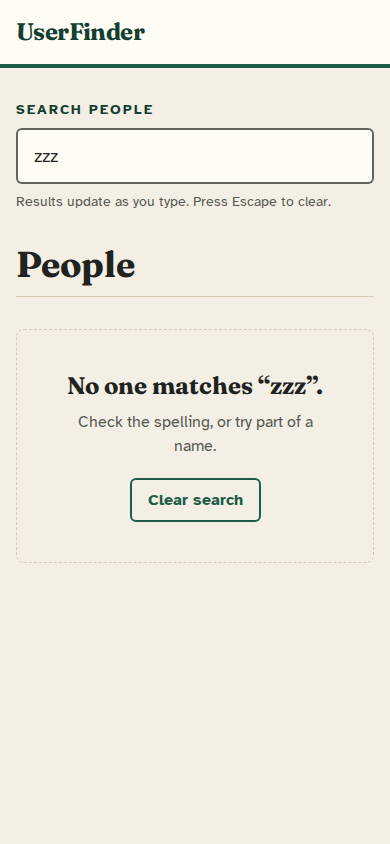
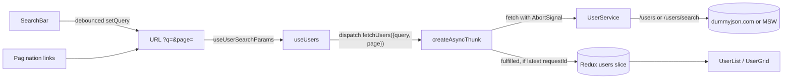

# UserFinder: user directory search

A small React app for looking people up in a directory: search by name, page through results, and open a profile with contact and company details. It reads from the public [dummyjson.com](https://dummyjson.com/docs/users) users API, or from a built-in set of fictional people when run in mock mode.

It started as a front-end take-home exercise and was later reworked: search moved to the server, the URL now holds the search state, stale responses are dropped, the loading/empty/error states and keyboard support were filled in, and it got its own visual design.



| Search results | Profile | Mobile | No matches |
| --- | --- | --- | --- |
|  |  |  |  |

The screenshots use the mock data, so every name, email and phone number in them is made up.

## What it does

- **Search as you type.** Input is debounced by 300 ms and sent to `/users/search`. Enter searches straight away and Escape clears the box.
- **Shareable URLs.** The search and page live in the query string (`/?q=ar&page=2`). Reloading, sharing a link, or using Back and Forward restores the same view. Typing replaces the current history entry, so Back skips over half-typed terms.
- **Pages, not infinite scroll.** Previous and Next links show 12 people per page. A page number past the end offers a link to the last page.
- **Profiles.** `/user/:id` shows contact and company details. Missing fields show "Not listed" and an unknown or malformed id shows "Person not found". "Back to people" returns to the search and page you came from.
- **Explicit states.** Each view has a loading placeholder, an empty state with a "Clear search" button, and an error message with "Try again".
- **Accessibility.** The search field has a visible label, results sit in a list, the result count is announced through a status region, and there is a skip link. Focus moves to the results heading after a page change and to the person's name when a profile loads. All text colours meet WCAG AA contrast.

## Running it

You need Node 22 (see `.nvmrc`).

```bash
npm ci
npm run dev        # http://localhost:5173, live dummyjson.com data
npm run dev:mock   # same app, fictional data, no network calls
```

Other scripts:

| Command | What it does |
| --- | --- |
| `npm test` | Runs the Vitest suite once (`npm run test:watch` to watch) |
| `npm run lint` | Runs ESLint |
| `npm run build` | Builds the production bundle into `dist/` |
| `npm run build:mock` | Builds the bundle with the mock API included |
| `npm run preview` | Serves the last build on http://localhost:4173 |

### With Docker

The image builds the bundle and serves it from nginx on port 8080 as the unprivileged `nginx` user.

```bash
docker build -t userfinder .
docker run --rm -p 8080:8080 userfinder

# offline demo with the fictional people
docker build --build-arg BUILD_MODE=mock -t userfinder:mock .
docker run --rm -p 8080:8080 userfinder:mock
```

### Configuration

| Variable | Default | Purpose |
| --- | --- | --- |
| `VITE_API_BASE_URL` | `https://dummyjson.com` | Base URL of any API with the dummyjson `/users` contract |

Copy `.env.example` to `.env` to change it locally, or pass `--build-arg VITE_API_BASE_URL=...` to `docker build`. Like every `VITE_` variable, it is baked into the bundle at build time.

## How it works



- `src/services/UserService.js` builds `limit`/`skip` requests and turns HTTP and network failures into readable messages. A 404 also gets `code: 'not_found'`.
- `src/store/UserSlice.js` keeps separate `list` and `detail` state. Each slot records the `requestId` of its latest request and ignores responses from older ones. A `condition` skips refetching a page that is already loaded, which is why going back from a profile is instant.
- `src/hooks/useUsers.js` fetches whenever the URL's query or page changes and aborts the previous request when they change again.
- `src/mocks/` holds the MSW handlers and the 30 fictional people. The tests, `dev:mock` and `build:mock` all use the same handlers.

A search request and its response look like this (mock data, same shape as dummyjson):

```http
GET https://dummyjson.com/users/search?limit=12&skip=0&q=rosa
```

```json
{
  "users": [
    {
      "id": 18,
      "firstName": "Rosa",
      "lastName": "Delgado",
      "email": "rosa.delgado@example.com",
      "phone": "+1 555-0127",
      "company": {
        "name": "Quillstone Press",
        "department": "Operations",
        "title": "Engineer",
        "address": { "address": "219 Market Street", "city": "Savannah", "state": "Georgia", "postalCode": "31401" }
      }
    }
  ],
  "total": 1,
  "skip": 0,
  "limit": 12
}
```

## Design choices

- **The URL is the source of truth for search state.** Redux holds fetched data and request status, not the search term. That makes links shareable and keeps Back and Forward honest. The input keeps its own draft and only syncs from the URL when the URL changes from outside (for example, Back).
- **Two guards against stale results.** Leaving a query aborts its request, and the reducer also drops any response whose `requestId` is not the latest. The second guard covers responses that were already in flight when the abort happened.
- **Server-side search.** The original version filtered only the pages already loaded, so most people could not be found. Searching through the API covers the whole directory.
- **Paging links instead of infinite scroll.** They give each page a URL, work from the keyboard, and avoid the duplicate cards the old append-on-scroll logic produced.
- **Tailwind 4 through `@tailwindcss/vite`.** Theme colours and fonts are CSS variables in `src/index.css`. Headings use Fraunces, body text Atkinson Hyperlegible, and contact details IBM Plex Mono, all from Google Fonts with system fallbacks.

## Tests

`npm test` runs 34 tests with Vitest, Testing Library and MSW:

- `UserService`: request URLs, the search endpoint, 404/500/network messages and aborts.
- `UserSlice`: overtaken responses and failures are ignored, aborts are not errors, pages replace rather than append, and list and detail state stay separate.
- `useDebouncedCallback`: timing, cancel, unmount, and picking up the latest callback.
- `UserList`: debounced search updates the URL, the newest search wins over a slow older one, state is restored from the URL, paging and focus, out-of-range pages, the empty state and Escape, and loading, error and retry.
- `UserDetails`: profile and focus, not-found for unknown and non-numeric ids (without an API call), retry, missing company data, the back link keeping the search, and unknown routes.

The MSW test server fails any request that has no handler, so the suite never reaches the real API.

## Limitations

- dummyjson decides which fields `/users/search` matches. The mock matches first name, last name and email.
- dummyjson is a public demo service with no uptime guarantee. If it is down, the app shows its error state, and `dev:mock` still works.
- `public/mockServiceWorker.js` is generated by MSW and also ships in production builds. It does nothing unless the app was built with `--mode mock`.

## License

MIT, see [LICENSE](LICENSE).
